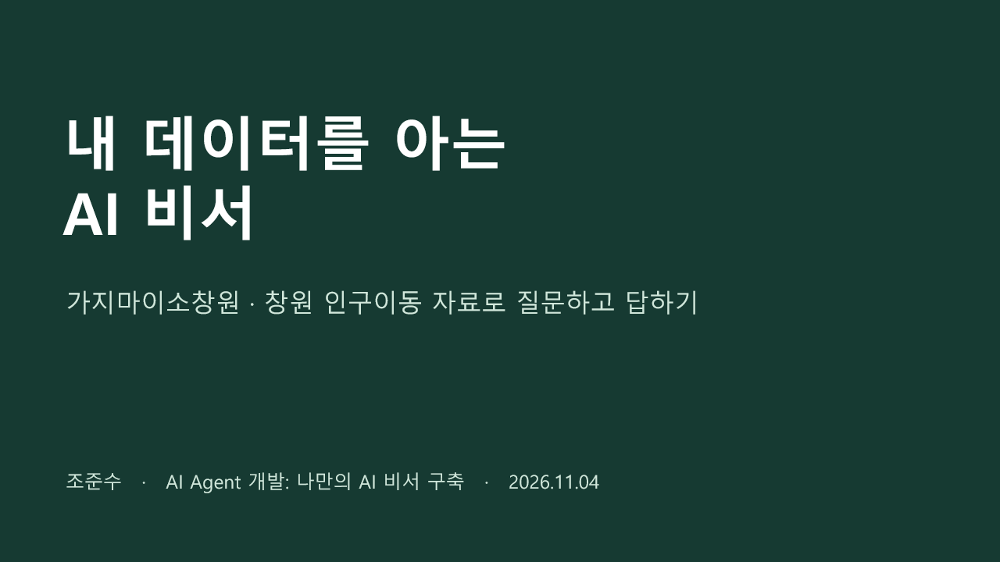

# 가지마이소창원 AI 비서 발표자료

**조준수 · 약8분 · 12장 · 쉬운 설명 중심**

## 목차와 파일

1. [발표용 PowerPoint](gajimaiso-presentation.pptx) — 실제 캡처3종과 슬라이드 노트 포함
2. [발표자료 설명·사용 안내](GUIDE.md) — 용어 풀이, 화면 설명 순서, 준비 체크
3. [슬라이드별 발표 스크립트](SCRIPT.md) — 8분 대본과3분 짧은 버전
4. [슬라이드 내용](SLIDES.md) — GitHub에서 바로 읽는 발표자료
5. [예상 질문·답변](Q_AND_A.md) — 쉽게 답하는12개 질문
6. [네이토100% 결과 요약](EVALUATION.md) — 사용자 제공 결과와 기존 실행 근거 구분

## 발표의 한 문장

> 저장된 데이터를 읽고, 핵심 내용을 정리해 AI에 전달하고, 답변을 저장해 다시 볼 수 있게 만들었습니다.

## 사용 방법

PowerPoint를 내려받아 발표하고, SCRIPT.md를 대본으로 사용합니다. 발표자 보기에서 슬라이드 노트를 읽을 수도 있습니다. PPT의 제목과 설명은 편집 가능하며, 실제 화면은 원본 캡처 이미지입니다. 정확한 낭독 시간은 한 번 연습해 조절하세요. GitHub에서는 PPTX가 바로 미리보기되지 않을 수 있으므로 파일을 다운로드하거나 SLIDES.md를 읽으면 됩니다.

## 평가와 브랜치

사용자가 제공한2026-11-04 12:52:16 네이토3차 사전평가는 **18/18·100%**입니다. 최종 동료평가 완료와는 별개입니다.

이 자료는 `docs/presentation-2026-11-04`라는 발표 전용 브랜치에 있습니다. 브랜치는 같은 프로젝트의 작업 버전을 별도로 관리하는 가지입니다. 기존 제출용 `main`에 합치거나 과제 평가 브랜치를 바꾸지는 않았습니다. 앱 코드·원본 자료·기존 질문은 변경하지 않았습니다.

## 서비스와 근거

- [웹 서비스](https://gajimaiso-ai-assistant.vercel.app/)
- [API 안내](https://gajimaiso-ai-assistant.onrender.com/docs)
- [필수 화면3종](../submission/SCREENSHOTS.md)
- [기존 검증 기록](../submission/CHECKLIST.md)

발표자료 제작은 기존 소스·실행 기록·캡처를 재사용했으며, 새 GPT 호출·DB 변경·추가 평가 요청을 하지 않았습니다.
