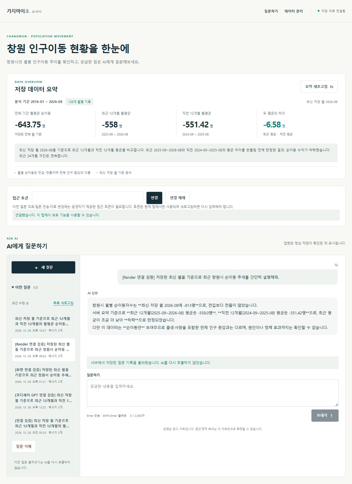
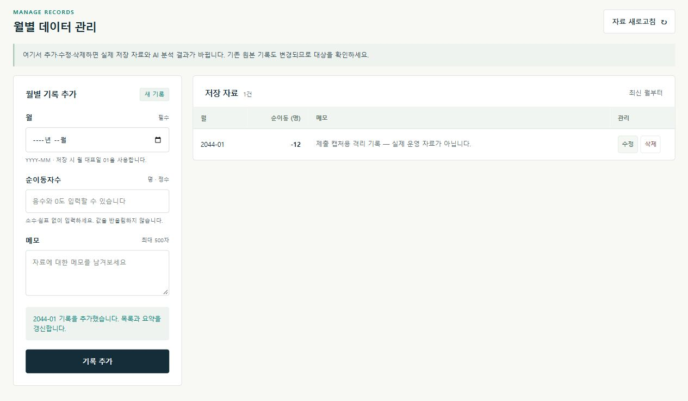
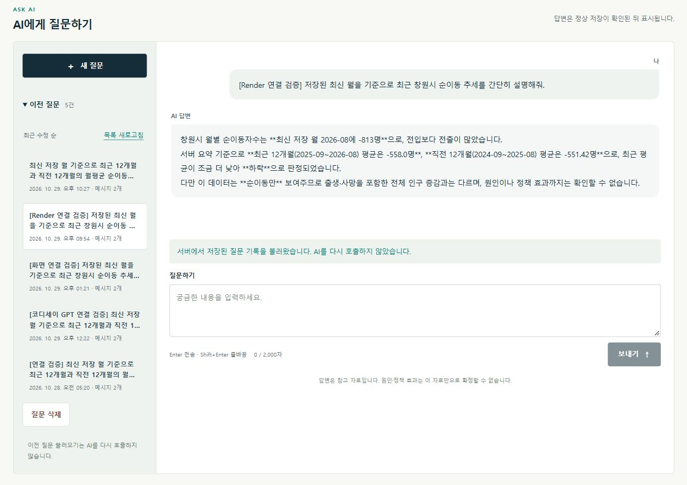

# 발표 슬라이드 내용

가지마이소창원 AI 비서 · 조준수 · 약8분 / 12장

## 목차

1. [내 데이터를 아는 AI 비서](#slide-01)
2. [발표 순서](#slide-02)
3. [AI가 내 자료를 읽게 하려면](#slide-03)
4. [사용한 자료: 창원시 월별 순이동](#slide-04)
5. [질문 한 번이 처리되는 과정](#slide-05)
6. [AI에게 건네는 ‘자료 요약’](#slide-06)
7. [질문과 자료가 연결된 답변](#slide-07)
8. [자료를 추가하면 목록도 갱신됩니다](#slide-08)
9. [이전 질문은 다시 불러옵니다](#slide-09)
10. [안전하게 쓰기 위한 기본 규칙](#slide-10)
11. [확인한 결과](#slide-11)
12. [한계와 다음 개선](#slide-12)

## 01. 내 데이터를 아는 AI 비서

가지마이소창원 · 창원 인구이동 자료로 질문하고 답하기

- 조준수
- AI Agent 개발: 나만의 AI 비서 구축
- 2026.11.04

근거: [README.md](../../README.md)

## 02. 발표 순서

- 01   왜 만들었고, 어떤 자료를 썼는가
- 02   자료가 AI의 답변으로 이어지는 과정
- 03   질문 · 자료 관리 · 이전 질문 화면
- 04   안전장치와 확인한 결과
- 05   한계와 다음 개선

근거: [README.md](../../README.md)

## 03. AI가 내 자료를 읽게 하려면

- 질문: “최근 창원의 인구이동은 어때?”
- 필요한 것: 저장된 통계와 분석 기준
- 구현한 방법: 핵심 내용을 정리해 질문과 함께 전달

**AI에게 자료를 건네는 과정까지 서비스가 맡습니다**

근거: [chat.py](../../backend/app/services/chat.py)

## 04. 사용한 자료: 창원시 월별 순이동

- 128개 월별 기록
- 2016년 1월 ~ 2026년 8월
- 순이동 = 들어온 사람 수 − 나간 사람 수

**설명용 예: 10명이 들어오고 13명이 나가면 −3명**

출처 기록: KOSIS 국내인구이동통계 · 순이동은 출생·사망을 포함한 전체 인구 증감과 다릅니다

근거: [changwon_migration_monthly_clean.csv](../../backend/data/source/changwon_migration_monthly_clean.csv)

## 05. 질문 한 번이 처리되는 과정

- ① 화면에서 질문을 보냅니다
- ② 서버가 저장 자료를 읽고 핵심 수치를 계산합니다
- ③ AI가 요약을 참고해 답합니다
- ④ 질문과 답변을 저장한 뒤 화면에 보여줍니다

**화면 → 자료 처리 → AI 답변 → 기록 저장**

화면: HTML/CSS/JavaScript · 처리: FastAPI · 저장: Firestore · AI: GPT

근거: [chat.py](../../backend/app/services/chat.py)

## 06. AI에게 건네는 ‘자료 요약’

- 어느 기간의 자료인가? → 2016-01 ~ 2026-08
- 자료가 얼마나 있는가? → 128개 월별 기록
- 최근 흐름은 어떤가? → 최근 12개월과 그 앞 12개월 비교
- 어디까지 설명할 수 있는가? → 원인·정책 효과는 단정하지 않음

**자료 요약 + 답변 기준을 함께 전달합니다**

이 방식을 ‘컨텍스트 주입’이라고 부릅니다 · 모델을 새로 학습시키는 방식은 아닙니다

근거: [chat.py](../../backend/app/services/chat.py) · [openai_client.py](../../backend/app/services/openai_client.py) · [summary.py](../../backend/app/services/summary.py)

## 07. 질문과 자료가 연결된 답변

- 최근 12개월 평균: −558명
- 그 앞 12개월 평균: −551.42명
- 차이: −6.58명 → 순유출 규모가 조금 커짐

2026-11-04 운영 화면 · 기존 실제 GPT 답변 불러오기 · 새 GPT 생성 장면은 아닙니다

근거: [06-gpt-summary-live-2026-11-04.jpg](../submission/screenshots/06-gpt-summary-live-2026-11-04.jpg) · [render-gpt-2026-10-29.json](../submission/evidence/render-gpt-2026-10-29.json)

## 08. 자료를 추가하면 목록도 갱신됩니다

- 월 · 값 · 메모 입력
- 저장 성공 안내
- 목록 1건 확인

2044-01 / −12명은 촬영용 가상 기록 · 실제 Firestore의 별도 시험 공간 사용 · 촬영 후 삭제

근거: [crud-capture-2026-11-04.json](../submission/evidence/crud-capture-2026-11-04.json) · [app.js](../../frontend/app.js)

## 09. 이전 질문은 다시 불러옵니다

- 목록에서 질문 선택
- 저장된 질문과 답변 재표시
- 불러올 때 GPT 재호출 없음

2026-11-04 운영 질문 목록 5건 중 기존 문답 선택 · 저장 기록을 읽는 동작

근거: [capture-verification-2026-11-04.json](../submission/capture-verification-2026-11-04.json) · [app.js](../../frontend/app.js)

## 10. 안전하게 쓰기 위한 기본 규칙

- 자료와 요약 보기 → 누구나
- 질문 · 기록 보기 · 자료 변경 → 운영자 접근 확인
- 잘못된 입력 → 저장 전에 확인
- 저장 여부가 불확실 → 목록부터 확인, 자동 재전송 안 함

**AI 비밀키는 서버에만 보관합니다**

접근 토큰은 서비스의 보호 기능을 여는 값이며, GPT API 키와 다릅니다

근거: [security.py](../../backend/app/security.py) · [main.py](../../backend/app/main.py) · [data.py](../../backend/app/schemas/data.py) · [app.js](../../frontend/app.js)

## 11. 확인한 결과

- 네이토 사전평가 18 / 18 · 100%
- 2026-10-29  실제 GPT 답변 · 자동 저장 · 복원 검증
- 2026-11-04  필수 화면 3종 · 공개 접근 · API 문서 반영 확인

사전평가: 사용자 제공 결과, 2026-11-04 12:52:16 · 최종 동료평가와는 별개입니다

근거: [EVALUATION.md](EVALUATION.md) · [render-gpt-2026-10-29.json](../submission/evidence/render-gpt-2026-10-29.json) · [pre-evaluation-verification-2026-11-04.json](../submission/pre-evaluation-verification-2026-11-04.json)

## 12. 한계와 다음 개선

- 현재: 저장된 수치와 추세를 설명
- 한계: 이동 원인 · 정책 효과 · 미래는 단정할 수 없음
- 다음: 사용자별 권한, 더 많은 자료를 다루는 요약 방식

**핵심은 AI가 참고할 자료와 답변의 범위를 정하는 일입니다**

서비스: gajimaiso-ai-assistant.vercel.app · 코드와 근거: GitHub jojunsu98/gajimaiso-ai-assistant

근거: [README.md](../../README.md) · [PRE_EVALUATION_RESPONSE.md](../submission/PRE_EVALUATION_RESPONSE.md)
