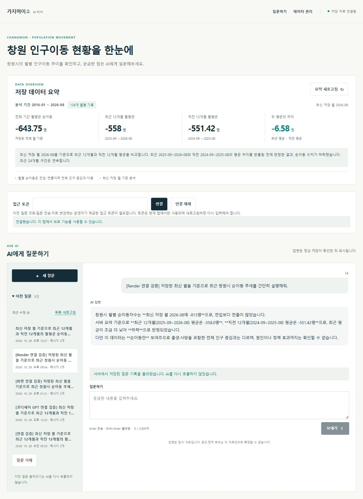
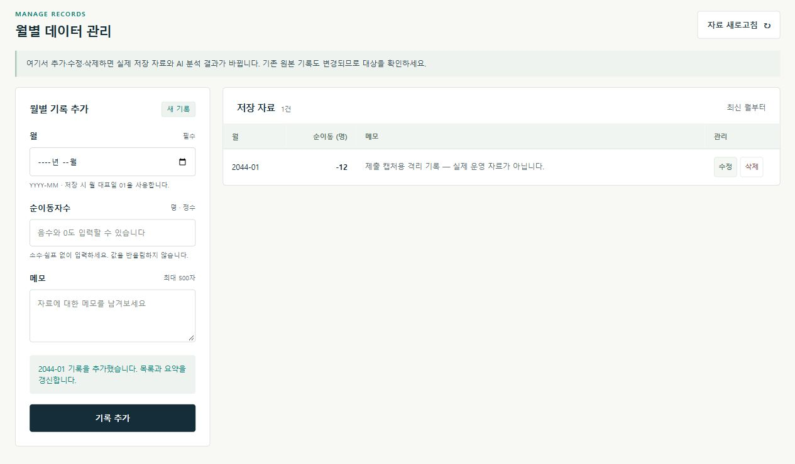
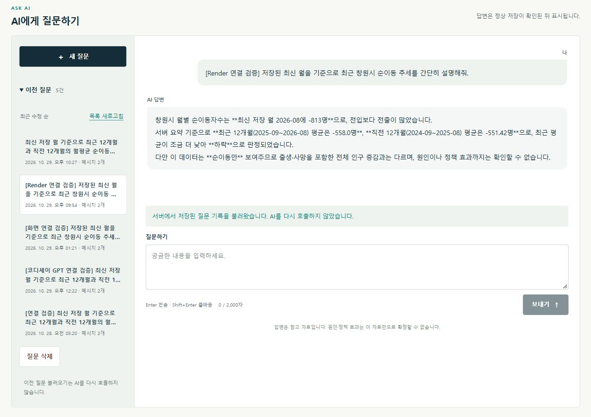

# 최종 제출 스크린샷 3종 — 2026-11-04

공식 과제의 요약·질문·답변, CRUD 동작 결과, 이전 질문 불러오기 조건을 아래 실제 브라우저 캡처로 확인합니다. 화면 내용을 합성하거나 성공 메시지를 임의로 넣지 않았습니다. [촬영 기록·파일 해시](capture-verification-2026-11-04.json).

## 1. 데이터 요약과 GPT 질문·답변

Vercel 운영 사이트에서2026-10-29 실제 GPT가 생성·저장한 Render 검증 질문을 선택했습니다. 상단128개월·기간·평균·추세와 하단 질문·저장 답변이 함께 보입니다. 최신2026-08/-813, 최근12개월 -558, 직전12개월 -551.42가 일치합니다. 새 GPT 생성0회입니다. [당시 생성·저장 기록](evidence/render-gpt-2026-10-29.json).

## 2. 데이터 관리 — 실제 추가 결과

원본 data와 다른 실제 Firestore 컬렉션 `_frontend_data_checks_submission_capture_20261104_01`에2044-01/-12 시연 기록1건을 추가했습니다. **추가 완료 안내·저장 자료1건·추가된 행**이 함께 보입니다. 메모에 운영 자료가 아닌 격리 기록임을 표시했습니다. HTTP201·요약 평균-12 반영도 확인했습니다.

동일한 프론트 app.js/api.js/styles.css와 백엔드 CRUD 서비스를 사용했고 별도 화면의 API 주소와 격리 안내 배너만 다릅니다. 촬영 후 소유 기록만 삭제·부재 확인했으며 원본128건과 기존 질문5건의 전체 내용·생성/수정시각 해시를 보존했습니다. [실행·정리·보존 결과](evidence/crud-capture-2026-11-04.json).

화면 수정/삭제 기능의 실제 동작은 기존 [격리 CRUD](evidence/crud-isolated-2026-10-29.json)와 [사용자 확인](evidence/crud-user-confirmation-2026-10-29.json)을 재사용합니다. 캡처 요건의 'CRUD 중1개 동작'은 이번 실제 추가 결과로 보여 줍니다.

## 3. 이전 질문 불러오기

Vercel의 이전 질문5건 중 Render 검증 질문을 선택했습니다. 선택된 목록 항목·저장 문답·**서버에서 저장된 질문 기록을 불러왔으며 AI를 다시 호출하지 않았다는 안내**가 보입니다. 토큰 입력란은 연결 시 비워져 비밀값이 캡처에 포함되지 않았습니다.

## 과거 증거와 구분

기존01~03 이미지는10월29일 이력이고 최초 제출 후보의 부족한 부분은 위06~08로 보완했습니다. 04~05는11월4일 공개 접속 보조 증거로 일부 영역이 잘려 필수3종으로 사용하지 않습니다. 질문 수는 과거2·3·4건에서 이번5건으로 달라졌지만 이번 작업에서는 운영 질문을 생성·수정·삭제하지 않았습니다. 이미지 확보와 실제 제출 접수는 구분합니다.
